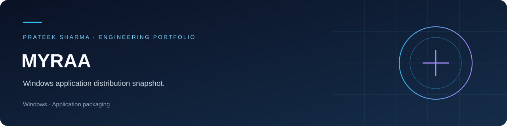
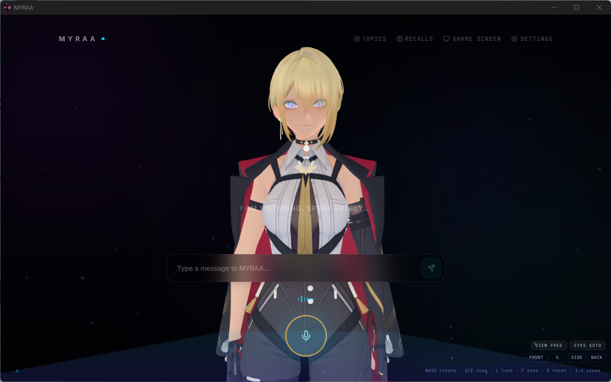

# Myraa

Windows application distribution snapshot.

**Focus:** Software distribution / project archive  
**Stack:** Windows · Application packaging

[LinkedIn](https://www.linkedin.com/in/prateek-sharma-97a064296/) · [Portfolio projects](docs/PORTFOLIO.md)

## Project overview

MYRAA desktop application installer.

## Interface preview

This screenshot shows a captured prototype session, rather than a new performance or runtime test.

## Engineering highlights

- MYRAA 1.0.1 Windows installer preserved as a release download
- Installer size and SHA-256 digest documented
- Distribution snapshot; application source is not present in this collection

## What I learned

I learned a lot by working through this project: reading code, troubleshooting integrations, comparing approaches, and understanding how individual components become a complete application. The main takeaways were:

- Understanding how a packaged installer is distributed separately from source.
- Using versioned releases and checksums to document an application artifact.

## Repository map

| Path | Contents |
|---|---|

## Downloads

[Open project releases](https://github.com/PRATEEK638/myraa/releases/tag/local-import-2026-10-10)

| File | Size | SHA-256 |
|---|---:|---|
| `MYRAA-Setup-1.0.1.exe` | 148.7 MiB | `e4a4fd9c8a3190444ea9e57a8fc9f18ef5531b52ca6a4417fc1e1fbb9d306fb0` |

## Project status

This is a development or study snapshot. Source import and upload checks are separate from runtime validation; the application and model behavior have not been retested as part of preparing this portfolio.
